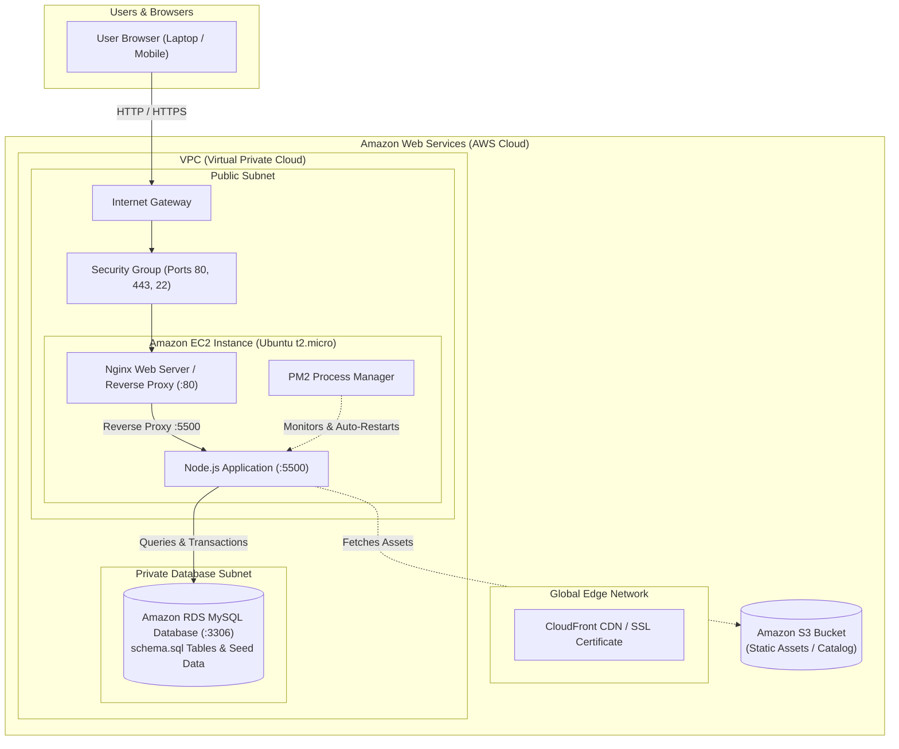
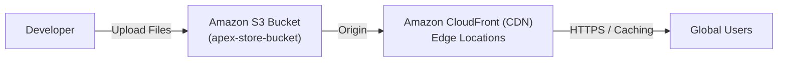

# ☁️ Apex Studio Store - AWS Cloud Deployment Guide
### Cloud Computing Mini Project (CCMiniProject)

This guide provides a step-by-step walkthrough for deploying the **Apex Studio Store** e-commerce application on Amazon Web Services (AWS). It covers two production-ready architectures:

1. **Architecture 1 (Recommended for CC Lab / Viva / Full-Stack):** Amazon EC2 + Nginx Reverse Proxy + PM2 + Amazon RDS (MySQL)
2. **Architecture 2 (Modern Cloud-Native / Serverless):** Amazon S3 Static Hosting + Amazon CloudFront CDN + Route 53

---

## 🏛️ System Architecture Diagram



---

## 🚀 ARCHITECTURE 1: Full-Stack Deployment on Amazon EC2

This is the standard architecture required in university Cloud Computing courses, lab exams, and production web setups.

### Phase 1: Launch an Amazon EC2 Instance

1. Log into your **AWS Management Console** ([aws.amazon.com](https://aws.amazon.com)).
2. Navigate to **EC2** and click **"Launch Instance"**.
3. Configure the instance:
   - **Name:** `ApexStore-WebServer`
   - **OS Image (AMI):** `Ubuntu Server 24.04 LTS` (or 22.04 LTS) - Free Tier eligible.
   - **Instance Type:** `t2.micro` (or `t3.micro` in newer regions) - 1 vCPU, 1 GB RAM (Free tier eligible).
   - **Key Pair:** Click **"Create new key pair"**:
     - Key pair name: `apex-key`
     - Key pair type: `RSA`
     - Private key file format: `.pem` (for OpenSSH / Mac / Linux / Windows PowerShell)
     - Click **Create key pair** and save the downloaded file securely.
4. **Network Settings (Security Group):**
   - Create a new Security Group: `ApexStore-SG`
   - Add the following **Inbound Rules**:
     | Type | Protocol | Port Range | Source | Purpose |
     | :--- | :--- | :--- | :--- | :--- |
     | **SSH** | TCP | `22` | Anywhere (`0.0.0.0/0`) or My IP | Remote shell access |
     | **HTTP** | TCP | `80` | Anywhere (`0.0.0.0/0`) | Public web traffic |
     | **HTTPS** | TCP | `443` | Anywhere (`0.0.0.0/0`) | Secure SSL traffic |
     | **Custom TCP** | TCP | `5500` | Anywhere (`0.0.0.0/0`) | Direct app port testing |
5. **Storage:** Keep the default `8 GiB gp3` (Free tier allows up to 30 GB).
6. Click **"Launch Instance"**.

---

### Phase 2: Connect to Your EC2 Instance

#### Option A: Using EC2 Instance Connect (Browser - Easiest)
1. In the EC2 Console, select your instance and click **Connect**.
2. Select **EC2 Instance Connect** and click **Connect**. A browser terminal will open.

#### Option B: Using SSH from Windows PowerShell / Terminal
1. Open PowerShell in the folder where your `apex-key.pem` is stored.
2. Fix permissions (Windows):
   ```powershell
   icacls .\apex-key.pem /inheritance:r
   icacls .\apex-key.pem /grant:r "$($env:USERNAME):(R)"
   ```
3. Connect using the Public IPv4 address of your EC2:
   ```bash
   ssh -i "apex-key.pem" ubuntu@<YOUR_EC2_PUBLIC_IP>
   ```

---

### Phase 3: Setup Server Environment (Ubuntu)

Run the following commands on your EC2 terminal:

```bash
# 1. Update package lists
sudo apt update && sudo apt upgrade -y

# 2. Install Node.js (v20 LTS) & npm
curl -fsSL https://deb.nodesource.com/setup_20.x | sudo -E bash -
sudo apt install -y nodejs git nginx

# 3. Verify installations
node -v
npm -v
nginx -v

# 4. Install PM2 globally (Process Manager to keep app alive 24/7)
sudo npm install -g pm2
```

---

### Phase 4: Deploy the Project Code

#### Method A: Clone from GitHub
```bash
cd /var/www
sudo git clone https://github.com/mr-inamdar/E-Com-Mini-Project.git apex-store
sudo chown -R ubuntu:ubuntu /var/www/apex-store
cd /var/www/apex-store
```

#### Method B: Upload directly from Windows using SCP
If your project is not on GitHub, run this from your local Windows PowerShell:
```powershell
scp -i "apex-key.pem" -r "c:\Users\HP\Desktop\WebDev\CCMiniProject\*" ubuntu@<YOUR_EC2_PUBLIC_IP>:/home/ubuntu/apex-store/
```
Then on EC2:
```bash
sudo mv /home/ubuntu/apex-store /var/www/apex-store
cd /var/www/apex-store
```

---

### Phase 5: Start the Application with PM2

PM2 ensures your app restarts automatically on system reboots or crashes:

```bash
cd /var/www/apex-store

# Start server.js under PM2
pm2 start server.js --name "apex-store"

# Save PM2 process list
pm2 save

# Setup PM2 to start on system boot
pm2 startup
# (Copy and execute the command that PM2 prints out)

# Check status
pm2 status
pm2 logs apex-store --lines 20
```

At this stage, you can already test your store by visiting:
`http://<YOUR_EC2_PUBLIC_IP>:5500`

---

### Phase 6: Configure Nginx as Reverse Proxy (Port 80 -> 5500)

Using Nginx allows visitors to type standard `http://<YOUR_IP>` without the `:5500` port, handles static caching, and enables SSL.

1. Create an Nginx configuration file:
   ```bash
   sudo nano /etc/nginx/sites-available/apex-store
   ```
2. Paste the following configuration:
   ```nginx
   server {
       listen 80;
       server_name _;

       # Root directory for static assets
       root /var/www/apex-store;
       index index.html;

       location / {
           proxy_pass http://127.0.0.1:5500;
           proxy_http_version 1.1;
           proxy_set_header Upgrade $http_upgrade;
           proxy_set_header Connection 'upgrade';
           proxy_set_header Host $host;
           proxy_set_header X-Real-IP $remote_addr;
           proxy_set_header X-Forwarded-For $proxy_add_x_forwarded_for;
           proxy_set_header X-Forwarded-Proto $scheme;
           proxy_cache_bypass $http_upgrade;
       }

       # Direct static file caching for high performance
       location ~* \.(css|js|png|jpg|jpeg|gif|ico|svg|json)$ {
           root /var/www/apex-store;
           expires 7d;
           add_header Cache-Control "public, no-transform";
       }
   }
   ```
3. Enable the site and restart Nginx:
   ```bash
   sudo rm /etc/nginx/sites-enabled/default
   sudo ln -s /etc/nginx/sites-available/apex-store /etc/nginx/sites-enabled/
   sudo nginx -t
   sudo systemctl restart nginx
   sudo systemctl enable nginx
   ```

Now open: **`http://<YOUR_EC2_PUBLIC_IP>`** directly in your browser! 🎉

---

### Phase 7: Connect to Amazon RDS (MySQL Database)

To complete the full-stack cloud setup with the included `schema.sql`:

1. In AWS Console, go to **Amazon RDS** -> **Databases** -> **Create Database**.
2. Settings:
   - **Engine:** MySQL (Version 8.0)
   - **Template:** **Free Tier**
   - **DB instance identifier:** `apex-db`
   - **Master username:** `admin`
   - **Master password:** `ApexSecurePass2026!`
   - **DB instance class:** `db.t3.micro` or `db.t4g.micro`
   - **Public Access:** Yes (for testing) or No (within same VPC)
   - **VPC Security Group:** Select `ApexStore-SG` (Ensure Port `3306` is open)
   - **Initial database name:** `apex_store`
3. Click **Create Database** (takes 5-8 minutes).
4. Note down the **RDS Endpoint** (e.g. `apex-db.cxxxxxx.ap-south-1.rds.amazonaws.com`).
5. On your EC2 instance, import `schema.sql`:
   ```bash
   sudo apt install -y mysql-client
   mysql -h <RDS_ENDPOINT> -P 3306 -u admin -p apex_store < /var/www/apex-store/schema.sql
   ```
6. In `script.js` or `server.js`, configure your DB connection pool using `mysql2`!

---

### Phase 8: Secure with Free SSL Certificate (HTTPS)

If you have a domain name pointed to your EC2 IP (via Route 53 or GoDaddy/Namecheap):

```bash
sudo apt install -y certbot python3-certbot-nginx
sudo certbot --nginx -d yourdomain.com -d www.yourdomain.com
```
Certbot automatically installs the SSL certificate, updates Nginx, and schedules auto-renewal via cron.

---

## ⚡ ARCHITECTURE 2: Serverless Static Deployment (S3 + CloudFront)

If you want a 100% serverless, zero-maintenance, zero-downtime deployment for the frontend:



### Steps:
1. **Create an S3 Bucket:**
   - Name: `apex-studio-store-bucket` (unique name).
   - Region: Nearest to your users (e.g., `ap-south-1`).
   - Uncheck **"Block all public access"** and acknowledge the warning.
2. **Enable Static Website Hosting:**
   - In Bucket Properties -> **Static website hosting** -> Click **Edit** -> **Enable**.
   - Index document: `index.html`
   - Error document: `index.html`
3. **Set Bucket Policy:**
   - Go to **Permissions** -> **Bucket Policy** -> Paste:
   ```json
   {
       "Version": "2012-10-17",
       "Statement": [
           {
               "Sid": "PublicReadGetObject",
               "Effect": "Allow",
               "Principal": "*",
               "Action": "s3:GetObject",
               "Resource": "arn:aws:s3:::apex-studio-store-bucket/*"
           }
       ]
   }
   ```
4. **Upload Files:**
   - Upload `index.html`, `design.css`, `script.js`, `pro.json`, `icon.png`, `logo.jpeg`.
5. **(Optional) Setup Amazon CloudFront:**
   - Create a CloudFront Distribution with the S3 bucket as Origin.
   - CloudFront distributes your website across 400+ Edge points worldwide with free HTTPS!

---

## 💡 Important Cloud Computing Viva & Evaluation Tips

When presenting this project for your lab examination or project review:

1. **What AWS services did you use and why?**
   - **Amazon EC2:** Virtual compute server (IaaS) running Linux Ubuntu.
   - **Nginx:** High-performance web server acting as a Reverse Proxy and static content caching layer.
   - **PM2:** Production-grade Node.js process manager providing zero-downtime reloads and automatic restarts.
   - **Amazon RDS:** Managed relational database service running MySQL with automated backups and failover.
   - **Amazon S3 & CloudFront:** Object storage and CDN edge caching for low-latency asset delivery.

2. **Why use Nginx in front of Node.js?**
   - Security: Hides the Node application port (`5500`) from direct public exposure.
   - Performance: Nginx serves static CSS/JS/images 5-10x faster using kernel-level cache (`sendfile`).
   - SSL Termination: Handles TLS encryption efficiently without CPU overhead on Node.js.

3. **How do you ensure zero downtime if the server restarts?**
   - Configured `pm2 startup` and `systemctl enable nginx` so services automatically resume after reboots.

4. **Cost Optimization / Free Tier Compliance:**
   - Always remember to stop or terminate EC2 instances when testing is complete to avoid consuming Free Tier hours.
   - Setup an **AWS Budget Alert** at `$1.00` to be notified immediately of any charges.
